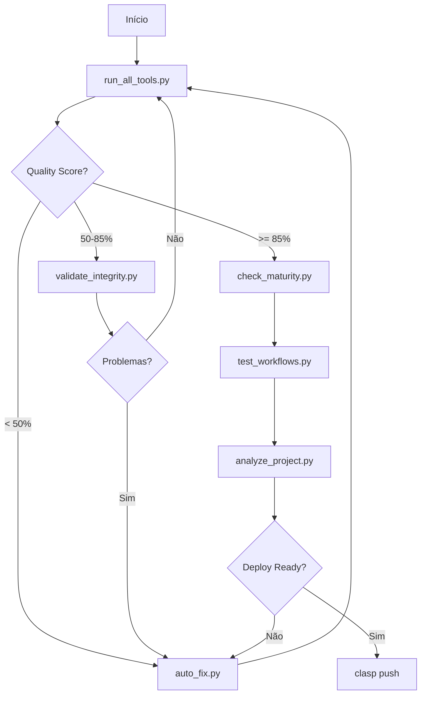

# 🌊 Lago Paranoá - Sistema de Monitoramento Limnológico

[](https://script.google.com)
[](https://sheets.google.com)
[](https://github.com)

## 📋 Sobre o Projeto

Plataforma **hidroinformática integrada** para gestão adaptativa do Lago Paranoá (DF), implementada 100% em **Google Apps Script** com arquitetura **Mobile-First** e **Offline-First**.

### 🎯 Objetivos

1. **Monitoramento Limnológico Real-Time**: IQA, IET, balneabilidade
2. **Gestão de Riscos**: Eutrofização, carga interna de fósforo, cianobactérias
3. **Ciência Cidadã**: Denúncias georreferenciadas, educação ambiental
4. **Governança Digital**: Fiscalização, compliance (CONAMA, ADASA)
5. **Inteligência Artificial**: Predição de blooms via Python/Colab (integração REST)

---

## 📊 Resultados da Análise Recente (Jan 2026)

Gráficos gerados pelo módulo de integração científica (Python/Colab):

| Limnologia & Eutrofização | Sedimentos & Poluição | Governança & Biodiversidade |
|:---:|:---:|:---:|
| [**KDE Fósforo Total**](https://drive.google.com/file/d/1HaAsabA747nLYjn6SWAcTNDFbjD45vW3/view?usp=drivesdk)<br>Distribuição de P na coluna d'água | [**Radar Sedimentos**](https://drive.google.com/file/d/15cS2Lp_YZ2Xbx5TuxpDZuShNICLtYKkK/view?usp=drivesdk)<br>Perfil geoquímico interno | [**Compliance Outorgas**](https://drive.google.com/file/d/1ir1Oy76K9_s-iNshX7czcdTMzX1nlhFz/view?usp=drivesdk)<br>Regularidade de usuários |
| [**KDE Clorofila-a**](https://drive.google.com/file/d/1V1pNwgXR7NiuhD5aaX3GCs3NBVaiH0LB/view?usp=drivesdk)<br>Biomassa fitoplanctônica | [**KDE Turbidez**](https://drive.google.com/file/d/1s20Tv1b0EJjxU4AIFH3VQsVIzc_74NqE/view?usp=drivesdk)<br>Sólidos em suspensão | [**Histograma Loteamentos**](https://drive.google.com/file/d/1XU9j5XRqkymgDoRbJV_xgJGOS0Ac5hMh/view?usp=drivesdk)<br>Pressão urbana |
| [**Violin IQA**](https://drive.google.com/file/d/1sdKFggAHvx-E9964_SUgs5pWiwoxMhAW/view?usp=drivesdk)<br>Qualidade da água por ponto | [**Violin Microplásticos**](https://drive.google.com/file/d/1WH5R-G974ro50vXY9mcsabDl2sLBcW2k/view?usp=drivesdk)<br>Contaminação antropocênica | [**Barras Denúncias**](https://drive.google.com/file/d/1s4FbN-HweZGJ87ongGPHaG12PZ3a6m_U/view?usp=drivesdk)<br>Tipologia de fiscalização |
| [**Barras Eutrofização**](https://drive.google.com/file/d/1dTeM4-ffdttFs2VvGIFNQgectD8oTftf/view?usp=drivesdk)<br>Relação P x Clorofila | [**Violin pH Anoxia**](https://drive.google.com/file/d/17AW8V7eIj6VizleQU_cieEDvKt0E-ry8/view?usp=drivesdk)<br>Risco de mortandade | [**Barras Biodiversidade**](https://drive.google.com/file/d/1iUzPYCXbnztx1Xzp3PWNyCGKFrbA2MwO/view?usp=drivesdk)<br>Índice de Stress |

📄 **Resultados Brutos:** [analysis_results.json](https://drive.google.com/file/d/1p9vg63uOdIe6ysKm5NQ1KBJX9CdMJ3-w/view?usp=drivesdk)

---

## 🏗️ Arquitetura


- **Frontend**: Google Sheets como interface principal
- **Backend**: Google Apps Script para lógica de negócios e integração
- **Banco de Dados**: Google Sheets e Google Drive para armazenamento de dados
- **Integração**: APIs do Google para serviços externos (ex: Clima, Satélites)
- **Segurança**: Autenticação via Google e permissões de acesso granular

---

## 🚀 Implantação

1. **Clone o repositório**: `git clone https://github.com/sutiliza-org/lago_paranoa.git`
2. **Abra o Google Sheets**: [Planilha Modelo](https://docs.google.com/spreadsheets/d/1A2B3C4D5E6F7G8/edit#gid=0)
3. **Vincule o Apps Script**: Extensões > Apps Script
4. **Cole o código**: Substitua o código padrão pelo código do repositório
5. **Salve e feche**: Salve as alterações e feche o editor de script
6. **Autorize o script**: Execute o script e autorize as permissões necessárias
7. **Configure os gatilhos**: Editar > Gatilhos do projeto atual > Adicionar gatilho

---

## 🛠️ Ferramentas de Análise

Este projeto inclui ferramentas Python avançadas para garantir qualidade e prontidão para produção.

### ⚡ Execução Rápida (SEM instalação!)

As ferramentas principais **NÃO requerem instalação de dependências** - usam apenas bibliotecas built-in do Python 3.8+.

```bash
# 🚀 RECOMENDADO: Execução integrada via run_all_tools.py
python run_all_tools.py

# Com configuração personalizada
python run_all_tools.py --config custom_config.json

# Modo quality-check (CI/CD)
python run_all_tools.py --quality-check

# Executar apenas ferramentas específicas
python run_all_tools.py --only auto_fix.py validate_integrity.py test_navigation_semantics.py

# Pular ferramentas específicas
python run_all_tools.py --skip test_workflows.py

# Via npm scripts
npm run tools          # Execução completa via run_all_tools.py
npm run tools:fast     # Pula testes longos

# Ferramentas individuais (não recomendado, use run_all_tools.py)
python auto_fix.py
python validate_integrity.py
python test_navigation_semantics.py
```

### 📋 Ferramentas Disponíveis

#### 1. **Executor de Ferramentas** (`run_all_tools.py`) ⭐ INTEGRADO

```bash
python run_all_tools.py [opções]
```

**Dependências:** ❌ Nenhuma (usa apenas built-in)

**Recursos NOVOS:**
- ✅ **Integração com config.json** - Configuração centralizada
- ✅ **Quality Score Calculation** - Métricas de qualidade do projeto
- ✅ **Recomendações Inteligentes** - Sugestões baseadas em resultados
- ✅ **Modo Quality-Check** - Para CI/CD pipelines
- ✅ Execução sequencial otimizada por prioridade
- ✅ Detecção automática de dependências externas
- ✅ Relatório JSON + HTML detalhado
- ✅ Exit codes baseados em taxa de sucesso

**Opções:**
```
--config FILE, -c FILE    Arquivo de configuração (padrão: config.json)
--skip FILE [FILE ...]    Pular arquivos específicos
--only FILE [FILE ...]    Executar apenas estes arquivos
--timeout N               Timeout por ferramenta (padrão: 120s)
--verbose, -v             Modo verboso
--quality-check           Falha se quality score < threshold
--list, -l                Lista ferramentas sem executar
```

**Exemplos:**
```bash
# Execução padrão (RECOMENDADO)
python run_all_tools.py

# Apenas validação e testes
python run_all_tools.py --only validate_integrity.py test_navigation_semantics.py

# Modo CI/CD (falha se quality < 85%)
python run_all_tools.py --quality-check

# Com timeout maior para testes longos
python run_all_tools.py --timeout 300

# Configuração personalizada
python run_all_tools.py --config production_config.json
```

#### 2. **Testes de Navegação e Semântica** (`test_navigation_semantics.py`) ✨ APRIMORADO

```bash
python test_navigation_semantics.py
# ou via run_all_tools.py (RECOMENDADO)
python run_all_tools.py --only test_navigation_semantics.py
```

**Dependências:** ❌ Nenhuma (usa apenas built-in)

**Novos recursos:**
- ✅ **Validação de config.json** - Verifica estrutura e integridade
- ✅ **Testes de Integração** - Verifica integração entre ferramentas
- ✅ **Validação de Imports** - Testa resolução de módulos
- ✅ **Verificação de Notebook** - Valida colab.ipynb
- ✅ Validação de arquivos críticos dinâmica (via config.json)
- ✅ Compilação de sintaxe Python
- ✅ Validação JSON

**Testes incluídos:**
- 📝 Arquivos críticos na raiz (dinâmico via config.json)
- 📦 Estrutura plana do projeto
- 📄 Arquivos .gs do Apps Script
- 🔗 Validade de JSONs
- 🐍 Sintaxe Python
- 🔌 Resolução de imports
- 📓 Existência do notebook Colab
- 🔗 Integração run_all_tools.py ↔ config.json
- 📋 Ferramentas configuradas vs existentes

#### 3. **Auto-Fix** (`auto_fix.py`) 🔧 APRIMORADO

```bash
python auto_fix.py
```

**Dependências:** ❌ Nenhuma (usa apenas built-in)

**Novos recursos:**
- ✅ Validação pós-correção automática
- ✅ Detecção de correções redundantes
- ✅ Relatório detalhado de validações

Corrige automaticamente:

- 📝 .gitignore incompleto
- 📦 package.json sem scripts
- 📂 Estrutura de diretórios
- ⚙️  appsscript.json ausente
- 🔒 .claspignore
- 🌍 .env.example template

**💾 Cria backup automático antes de modificar arquivos!**

#### 4. **Análise Completa do Projeto** (`analyze_project.py`) 📊 CORRIGIDO

```bash
python analyze_project.py
# ou
npm run analyze
```

**Dependências:** ❌ Nenhuma (usa apenas built-in)

**Correções:**
- ✅ Import de logging adicionado
- ✅ Melhor tratamento de erros
- ✅ Análise mais robusta

Executa análise integrada incluindo:

- ✅ Verificação de maturidade
- ✅ Análise de estrutura
- ✅ Verificação de segurança
- ✅ Prontidão para deploy
- ✅ Estatísticas de código

#### 5. **Verificação de Maturidade** (`check_maturity.py`)

```bash
python check_maturity.py
# ou
npm run check
```

**Dependências:** ❌ Nenhuma (usa apenas built-in)

Gera relatório HTML com:

- 📊 Métricas de código (linhas, funções, classes)
- 🔍 Code smells detectados
- 💡 Recomendações priorizadas
- 📈 Score de maturidade

#### 6. **Validação de Integridade** (`validate_integrity.py`)

```bash
python validate_integrity.py
# ou
npm run validate
```

**Dependências:** ❌ Nenhuma (usa apenas built-in)

Valida:

- 🔗 Consistência do .clasp.json
- 📦 Dependências do package.json
- 🔗 Referências entre arquivos
- ⚙️  Manifesto appsscript.json
- 🔒 Arquivos de segurança

#### 7. **Testes de Workflows** (`test_workflows.py`)

```bash
python test_workflows.py
# ou
npm run test:workflows
```

**Dependências:** ❌ Nenhuma (usa apenas built-in)

Simula fluxos de usuários:

- 👤 Colaborador (férias, reembolsos, ponto)
- 👔 Gestor (aprovações, relatórios)
- 🔧 Admin (cadastros, deploy, backup)

Gera relatório JSON com métricas de performance.

---

### 🔄 Fluxo Recomendado



### 📊 Interpretando Relatórios

#### Relatório run_all_tools (`execution_report_*.json`)

```json
{
  "quality_metrics": {
    "quality_score": 92.5,
    "quality_status": "✅ APROVADO",
    "min_quality_threshold": 85,
    "recommendations": [
      "🌟 EXCELENTE: Projeto em ótimo estado!",
      "Considere executar: python test_workflows.py para testes avançados"
    ]
  },
  "summary": {
    "total_tools": 8,
    "success": 7,
    "warning": 1,
    "error": 0,
    "timeout": 0,
    "skipped": 0,
    "success_rate": "87.5%"
  }
}
```

**Interpretação:**
- **Quality Score > 85%**: ✅ Pronto para produção
- **Quality Score 70-85%**: ⚠️ Necessita ajustes
- **Quality Score < 70%**: 🔴 Melhorias críticas necessárias

#### Relatório de Maturidade (`maturity_report.html`)

- **Score > 80%**: ✅ Pronto para produção
- **Score 60-80%**: ⚠️  Necessita ajustes
- **Score < 60%**: 🔴 Melhorias críticas necessárias

#### Relatório de Ferramentas (`tools_report_*.json`)

```json
{
  "summary": {
    "total": 5,
    "successful": 5,
    "failed": 0,
    "success_rate": 100.0
  },
  "results": {
    "auto_fix.py": {
      "success": true,
      "duration": 2.45,
      "has_external_deps": false
    }
  }
}
```

#### Validação de Integridade

- **0 Issues**: ✅ Projeto íntegro
- **1-3 Warnings**: ⚠️  Atenção recomendada
- **>3 Issues**: 🔴 Correção obrigatória

### 🔧 Requisitos Mínimos

✅ **Python 3.8+** (nada mais!)

As ferramentas principais usam **APENAS bibliotecas built-in**:

- `pathlib` - Manipulação de caminhos
- `json` - Parse JSON
- `logging` - Sistema de logs
- `os`, `sys` - Sistema operacional
- `subprocess` - Execução de processos
- `datetime` - Data/hora
- `re` - Expressões regulares
- `collections` - Estruturas de dados
- `argparse` - CLI arguments
- `concurrent.futures` - Execução paralela
- `typing` - Type hints

### 📝 Logs

Todas as ferramentas geram logs em:

- `run_all_tools.log` - Log consolidado
- `workflow_tests.log` - Logs de testes
- Relatórios JSON/HTML no diretório raiz

### 🆘 Troubleshooting

**Problema:** Quality score baixo

```bash
# Solução 1: Execute auto-fix
python run_all_tools.py --only auto_fix.py

# Solução 2: Veja recomendações no relatório
cat results/execution_report_*.json | grep recommendations

# Solução 3: Valide integridade
python run_all_tools.py --only validate_integrity.py
```

**Problema:** Testes de semântica falhando

```bash
# Execute apenas os testes para ver detalhes
python test_navigation_semantics.py -v

# Ou via run_all_tools.py
python run_all_tools.py --only test_navigation_semantics.py --verbose
```

**Problema:** config.json inválido

```bash
# Valide o JSON
python -m json.tool config.json

# Execute validação
python run_all_tools.py --only validate_integrity.py
```

### 🎯 Próximos Passos

1. ✅ Executar `python run_all_tools.py` (OBRIGATÓRIO)
2. ✅ Revisar relatório `results/execution_report_*.json`
3. ✅ Seguir recomendações do quality score
4. ✅ Se score >= 85%, executar `npm run deploy` ou `clasp push`
5. 🚀 Se score < 85%, corrigir issues e repetir passo 1

### 💡 Dica Pro

Para uma análise completa rápida:

```bash
# ⭐ MELHOR OPÇÃO: Execução integrada
python run_all_tools.py --verbose

# 🚀 Para CI/CD
python run_all_tools.py --quality-check

# 🔍 Para debugging
python run_all_tools.py --only test_navigation_semantics.py validate_integrity.py --verbose

# 📊 Para relatório HTML bonito
python run_all_tools.py
# Depois abra: results/execution_report_*.html
```

---

**Made with ❤️ for Environmental Monitoring**  

**🚀 Zero Dependencies • 100% Python Built-in • CI/CD Ready**
